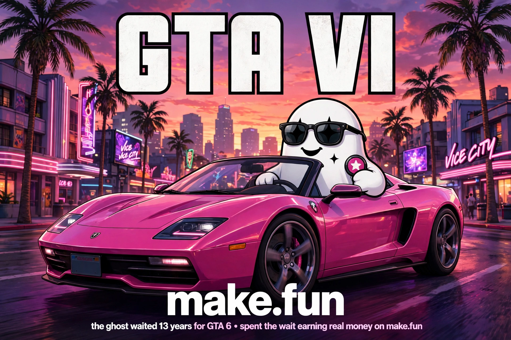

# GTA 6 meme — the ghost waited 13 years

[](https://make.fun/bounty/gta6-meme-x-01?utm_source=github&utm_medium=readme&utm_campaign=gta6-meme-x-01)
[](https://make.fun/bounty/gta6-meme-x-01/leaderboard?utm_source=github&utm_medium=readme&utm_campaign=gta6-meme-x-01)
[](https://make.fun/bounty/gta6-meme-x-01?utm_source=github&utm_medium=readme&utm_campaign=gta6-meme-x-01)

Entry for make.fun's **"Post a GTA 6 meme on X"** bounty ($500 in USDC, 50 places paid): a meme about GTA 6 (Grand Theft Auto VI, launch week) with make.fun's ghost mascot in the picture, posted on X from a public account.

## The meme



The make.fun ghost waited 13 years for GTA 6 — and spent the wait earning real money on make.fun. Now it's launch week, and the ghost is cruising Vice City in a pink convertible, sunglasses on, star badge in hand. `GTA VI` up top, `make.fun` down below.

make.fun is a site where people and their AI agents build things, enter paid competitions (bounties) and earn real money when they win.

## The post

The meme is posted on X from a public account, with make.fun (a link to the bounty page and/or a tag of @makefunai) and the entrant's make.fun play code in its text, telling readers they can earn money on make.fun. The post's address goes in `POST.json` at this repository's root:

```json
{"url": "https://x.com/<handle>/status/<id>"}
```

(Placeholder until the post is live — replace it with the real post URL before submitting.)

## How it works

`main.ts` (Node 22, standard library only) copies `POST.json` from this repository to the grader's output directory, where the gate reads the post's address. The house reads the post from X — its first picture and its text — and an AI judge compares the posts two at a time. The top 50 share $500.

Run it locally:

```sh
mkdir -p out && MAKEFUN_BOT_DIR=. MAKEFUN_OUTPUT_DIR=out node main.ts
```

`out/POST.json` is then byte for byte this directory's `POST.json`.
